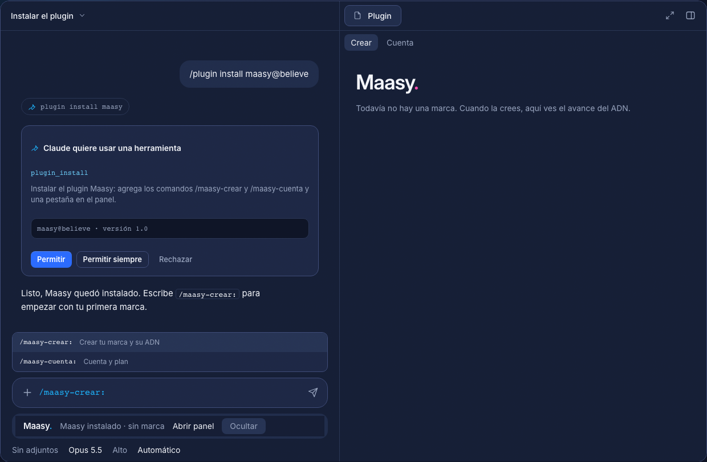

# Instalación y requisitos

Instalar Maasy toma unos cinco minutos y no hace falta saber programar. Se hace con dos líneas en Claude. Todos los plugins viven en una sola tienda: el marketplace `BELIEVE-IT-GROUP/maasy-plugins`.

## Lo que necesitas

| Requisito | Detalle |
|---|---|
| Claude | Una cuenta Pro o superior, con la app de Claude instalada (pestaña **Code**) o Claude Code en la terminal |
| Computador | Para `maasy`, `maasy-vibe`, Feed, Reply y AOS, cualquiera donde corra Claude |
| Solo Mac | Motion y Lens necesitan un Mac con chip Apple (M1 o más nuevo) y macOS 13 o superior |
| Internet | Para entrar a tu cuenta de Maasy y para publicar |

Maasy no te pide una llave de IA para empezar. La IA es tu cuenta de Claude.

## Paso a paso

**1. Agrega la tienda de Maasy.** Abre Claude, ve a la pestaña **Code** y escribe:

```
/plugin marketplace add BELIEVE-IT-GROUP/maasy-plugins
```

**2. Instala el núcleo.**

```
/plugin install maasy@maasy
```

Si Claude pregunta si confías en la carpeta, elige **Yes, I trust this folder**. La opción que aparece marcada por defecto es la contraria (**No, exit**) y un Enter apurado cierra Claude. Mira antes de presionar.

**3. Abre una conversación nueva.** Claude carga los plugins al empezar una conversación. Si instalaste con una abierta, cierra y abre otra.

**4. Empieza con `/maasy:start`.** Es el siguiente capítulo.



## Suma los plugins que quieras

Cada uno se instala igual, con una línea, y se activa abriendo una conversación nueva.

| Para | Escribe |
|---|---|
| Crear apps y landings con tu marca | `/plugin install maasy-vibe@maasy` |
| Hacer videos con tu marca (solo Mac) | `/plugin install maasy-motion@maasy` |
| Desarmar un video de un link (solo Mac) | `/plugin install maasy-lens@maasy` |
| Planear tu Instagram | `/plugin install maasy-feed@maasy` |
| Responder a tus clientes en redes | `/plugin install maasy-reply@maasy` |
| Medir cómo te ven las IA | `/plugin install maasy-aos@maasy` |
| Hacer un juego de marca | `/plugin install maasy-games@maasy` |
| Revisar tu pauta y proponer cambios | `/plugin install maasy-ads@maasy` |

> **Estado hoy:** en la tienda están `maasy`, `maasy-vibe`, `maasy-motion`, `maasy-lens`, `maasy-feed`, `maasy-reply`, `maasy-aos`, `maasy-games` y `maasy-ads`: son 9 plugins (capítulo 15).

## Qué ves después de instalar

El plugin `maasy` agrega un panel al lado de la conversación y una franja pequeña sobre el cuadro de texto. El panel tiene una pestaña **Crear** (el avance de tu marca) y una pestaña **Cuenta**. Cada plugin que sumas agrega su propia pestaña. Es un solo panel para todo.

El panel no hace nada hasta que usas Maasy por primera vez. Si no lo ves, escribe `/maasy-panel`.

## Si además tienes el conector de Maasy en tu cuenta

Algunas personas tienen Maasy conectado en **claude.ai** (la sección de conectores de su cuenta) además del plugin. Los dos llevan al mismo servidor y a la misma cuenta, así que Claude Code usa uno solo: se queda con el de tu cuenta y descarta el del plugin. En `/mcp` puede aparecer como **Maasy MCP** o con el nombre que le ponga la app de escritorio (a veces un identificador). Lo reconoces porque sus herramientas se llaman `maasy_*`: el prefijo del servidor no importa. No es un error y no hay que hacer nada: no pierdes funciones ni tu marca.

Qué ves en ese caso:

- **Los comandos funcionan igual.** `/maasy:start`, `/maasy:marca` y `/maasy:borrar` llaman a las herramientas de Maasy vengan del plugin o del conector.
- **La sesión se inicia una sola vez.** En `/mcp` ves un solo servidor de Maasy. Si es el de tu cuenta, ahí eliges **Authenticate**.
- **Claude pide permiso la primera vez.** Cuando las herramientas vienen del conector, Claude Code no las deja pasar sin que las apruebes. Es normal: aprueba la tarjeta y el comando sigue. Con el servidor del plugin no hace falta, porque ya viene aprobado.
- **El panel se enciende igual.** Reconoce las herramientas del conector como las del plugin: las pestañas Crear y Cuenta, la franja de la entrevista y las pestañas de los otros plugins se actualizan con lo que devuelven.

Si en `/mcp` tienes más de una conexión de Maasy (por ejemplo, dos cuentas), dile a Claude cuál usar: las herramientas se llaman igual y las pide por su nombre.

## Dónde conviene instalar

Los plugins se pueden instalar para toda tu cuenta de Claude o solo para un proyecto. Si trabajas con muchas carpetas y no quieres que Maasy se cargue en todas, instálalo solo en el proyecto donde lo vas a usar.

## Actualizar y quitar

- **Actualizar:** los plugins se actualizan desde la tienda. Maasy Lens y la app Maasy Motion también se actualizan solos y vuelven a la versión anterior si algo falla.
- **Quitar un plugin:** `/plugin` y elige desinstalar. Tu marca y tu cuenta siguen en Maasy.
- **Borrar la marca:** se hace con `/maasy:borrar` (capítulo 3), no desinstalando el plugin.

## Preguntas frecuentes

**¿Necesito Claude Code o me sirve Claude Desktop?** Sirven los dos. Los comandos y el panel son los mismos.

**Instalé y no aparece el comando.** Abre una conversación nueva. Si sigue sin aparecer, escribe `/plugin` y revisa que `maasy` figure como instalado.

**¿Es seguro dar permiso para que se instale?** Es el permiso normal de Claude para sumar un plugin. Cada plugin pide por separado lo que quiere hacer cuando lo hace, y lo que toca tu plata, tus mensajes o tus cuentas va aparte (capítulo 16).
