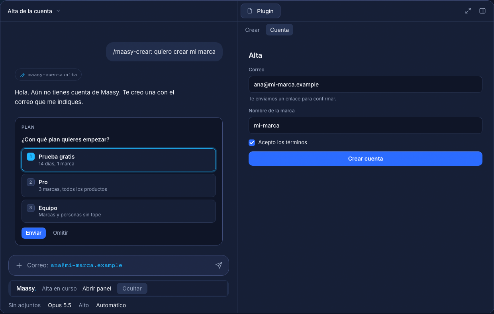
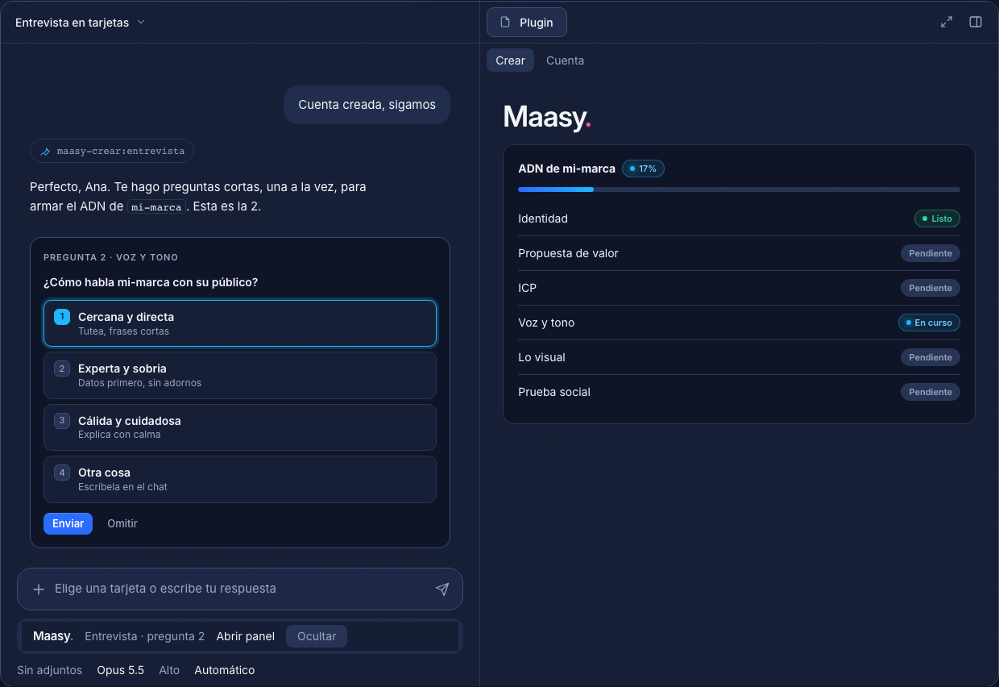
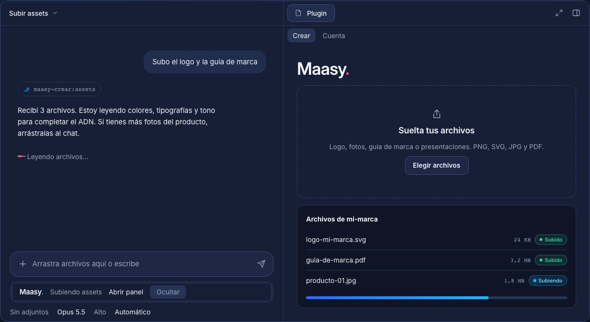
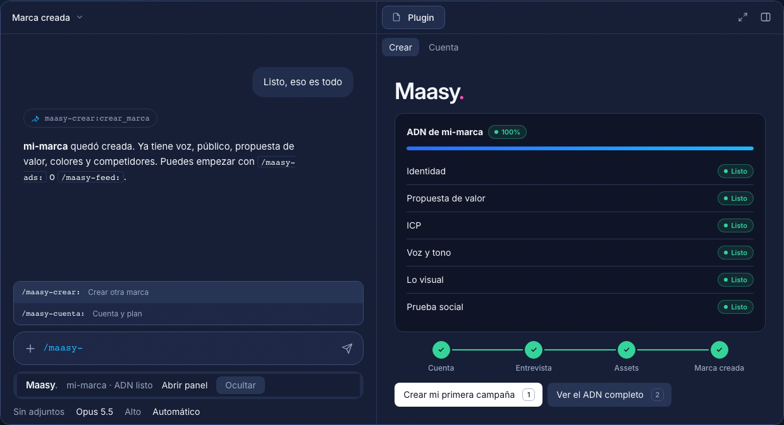

# Maasy: tu cuenta y tu marca

`maasy` es el plugin núcleo. Crea tu cuenta, te hace una entrevista sobre tu negocio y deja tu marca lista: su ADN, su identidad visual y su cerebro. Es el paso más importante de todo el sistema, porque cada plugin posterior trabaja con lo que aquí queda guardado.

## Qué hace

- Crea tu cuenta de Maasy gratis, sin tarjeta.
- Te entrevista con tarjetas de opción múltiple, una pregunta a la vez.
- Recibe tu logo, tus fuentes y tus imágenes de producto.
- Genera por ti lo que no tendrías que escribir: ángulos de venta, pilares de contenido, design system y design.md.
- Crea la marca con su cerebro ya cargado.
- Te muestra el avance en un panel al lado del chat.

Los pilares de contenido y los ángulos de venta no se escriben a mano. Salen de tus respuestas. Tú puedes quitar los que no te sirvan, pero no inventarlos desde cero.

## Cómo se instala

```
/plugin marketplace add BELIEVE-IT-GROUP/maasy-plugins
/plugin install maasy@maasy
```

Detalle completo en el capítulo 2.

## Paso a paso: tu primera marca

Escribe `/maasy:start`. Si ya tienes tu web o tu Instagram a mano, puedes escribirlos en el mismo comando: `/maasy:start misitio.com`. Claude no te los vuelve a preguntar.

### 1. Tu cuenta

La primera vez, Claude abre una ventana del navegador para que entres con Google o con tu correo. Ahí mismo se crea tu cuenta gratis. Cuando terminas, vuelves a Claude y la entrevista sigue sola.

Si la ventana no se abre, o la sesión no continúa, haz esto a mano: escribe `/mcp`, elige **maasy**, elige **Authenticate** y después vuelve a escribir `/maasy:start`.



Con tu cuenta gratis tienes una marca. Si ya la usaste, Claude te lo dice antes de empezar y te enlaza a los planes.

### 2. La entrevista en tarjetas

Claude te hace preguntas cortas, una por vez, con opciones que puedes elegir con un clic. También puedes escribir tu propia respuesta. Si ninguna opción te encaja, elige **Más opciones** y verás otras.

La entrevista tiene estas partes:

| Parte | Qué cuenta de tu negocio |
|---|---|
| Identidad | Quién eres, qué vendes, en qué país y a qué precio. Claude lee tu web o tu Instagram y te propone, tú confirmas |
| Propuesta de valor | Qué resultado das, contra quién compites y qué te diferencia |
| Cliente ideal | Quién te compra y qué le duele. Claude arma el perfil y tú lo ajustas |
| Voz y tono | Cómo hablas: tuteo, uso de emojis, palabras que sí y que no |
| Lo visual | Colores, fuentes, estilo de imagen, logo y referencias |
| Prueba social | Resultados, testimonios y reconocimientos |
| Salida | Idioma del contenido, largo de los textos y llamados a la acción |



La entrevista se guarda en un borrador. Si cierras Claude a la mitad, la retomas con `/maasy:start` donde la dejaste. Si quieres empezar de cero, Claude te pide una confirmación antes de descartar el borrador.

### 3. Tus archivos

Cuando llega la parte visual, subes tu logo, tus fuentes y tus imágenes de producto. Hay dos caminos:

- **Por link.** Si el archivo está en una dirección pública (https), Claude la usa directamente. Es el camino normal.
- **Desde tu computador.** Claude te confirma qué archivo, mide su tamaño y lo sube. Esta subida te pide permiso y te muestra la dirección de destino. Nunca sube un archivo que no elegiste tú.

Tus fuentes y tus imágenes de producto quedan privadas. El logo es lo único que tiene una copia pública, porque aparece en tus landings, tus correos y tus anuncios.



### 4. Referencias de marca

Si tienes referencias visuales (marcas que te gustan, piezas que quisieras parecer), súbelas en esta misma parte. Claude mira cada imagen y describe su estilo. Maasy suma esas lecturas en un perfil de referencias y a partir de él arma tu design system, tu biblioteca de ambientes y tu biblioteca de escenas. Así tus piezas heredan un criterio visual propio y no el de cualquier plantilla.

En la web de Maasy este circuito se ve en el panel Anti-Look Maasy.

### 5. Lo que se genera solo

Con tus respuestas listas, Claude hace ocho derivaciones. Te muestra cada una y la guarda con una llave del servidor. Si no te convence un elemento, puedes quitarlo.

```figura
<figure class="vx-fig" data-alt="Tus respuestas de la entrevista alimentan ocho derivaciones: perfiles de cliente ideal, ángulos de venta, pilares de contenido, perfil de referencias, design system, biblioteca de ambientes, biblioteca de escenas y design.md. Al final se crea la marca con su cerebro.">
  <div class="vx-head">De tus respuestas a tu marca</div>
  <div class="vx-body">
    <div class="vx-node"><span class="vx-tag">Tú respondes</span>Identidad, propuesta, cliente ideal, voz, lo visual, prueba social<small>Tarjetas de opción múltiple. Tus archivos van aparte.</small></div>
    <span class="vx-down" aria-hidden="true">&darr;</span>
    <div class="vx-grid vx-c4">
      <div class="vx-node">Perfiles de cliente ideal</div>
      <div class="vx-node">Ángulos de venta</div>
      <div class="vx-node">Pilares de contenido</div>
      <div class="vx-node">Perfil de referencias</div>
      <div class="vx-node">Design system</div>
      <div class="vx-node">Biblioteca de ambientes</div>
      <div class="vx-node">Biblioteca de escenas</div>
      <div class="vx-node">design.md</div>
    </div>
    <span class="vx-down" aria-hidden="true">&darr;</span>
    <div class="vx-node vx-key"><span class="vx-tag">Resultado</span>Tu marca, creada<small>ADN completo y cerebro cargado desde el primer día.</small></div>
  </div>
  <figcaption>Tú contestas preguntas fáciles. Los ángulos, los pilares y el design system los arma el sistema con tus respuestas.</figcaption>
</figure>
```

### 6. Tu marca queda creada

Claude crea la marca con todo lo anterior y te da el enlace para verla en Maasy. Si faltaba algún archivo por procesar, te avisa cuál y lo intenta una vez más.



El cerebro de tu marca se carga al crearla: tu ADN queda guardado para que cualquier plugin lo consulte. Con el tiempo se suman las piezas que apruebas y las que descartas.

## El panel de Maasy en Claude

El panel vive a la derecha de la conversación y es único para todos los plugins.

| Pestaña | Qué muestra |
|---|---|
| Crear | El avance de tu entrevista por parte y la marca activa |
| Cuenta | Tu plan, cuántas marcas usas y el enlace a la web de Maasy |
| Vibe, Motion, Lens, Feed, Reply, AOS | Lo que cada plugin aporta, apenas lo instalas |

Sobre el cuadro de texto hay una franja corta que dice en qué estás (por ejemplo, "Entrevista, pregunta 2") con los botones **Abrir panel** y **Ocultar**.

## Leer tu CRM

Con el plan Pro, Claude puede leer tu CRM de Maasy: contactos, leads, oportunidades, el pipeline y las actividades. Sirve para preguntas como "¿qué leads llevan más de una semana sin respuesta?". Hoy es solo lectura. Crear un contacto, actualizar un lead o dejar una nota necesitan un permiso aparte, que apagas o enciendes al conectar el plugin, y están pendientes de la política de privacidad del CRM. El CRM completo se maneja en la web de Maasy.

## Borrar una marca

`/maasy:borrar` borra una marca que creaste desde Claude en el plan gratis y libera tu cupo al instante.

1. Escribe `/maasy:borrar` y el nombre de la marca (o elígela de la lista).
2. Claude te explica qué se borra y te pide que escribas el nombre exacto de la marca.
3. Claude pide un permiso aparte para la tool de borrado. Es una segunda barrera a propósito.
4. Si lo que escribiste coincide, la marca desaparece de todas partes. Sus datos y archivos se eliminan del todo a los 30 días.

Con el plan gratis solo se puede borrar una marca propia, que nadie más esté usando y que no opere Believe. Si tu marca es del plan Pro, solo su dueño puede borrarla: Claude te muestra una tarjeta con lo que se borra y cuánto baja tu factura, y borra solo con tu sí (capítulo 5). Cualquier otra marca se borra desde la web de Maasy. Las tarjetas que tengas en el canvas se van con la marca.

## Idioma

Claude te habla en tu idioma. Las tarjetas de la entrevista y los correos de Maasy salen en español o en inglés según el idioma de tu cuenta. El contenido que se produce (posts, textos de landings, guiones) sale en el idioma de salida de tu marca, que eliges en la entrevista. Pueden ser distintos: tú en inglés y tu marca en español, por ejemplo.

## Límites

- El plan gratis es una marca. Para más marcas hay que pasar a un plan (capítulo 5).
- En el plan gratis el cerebro no se sirve a los plugins de producto. Esa conexión es del plan Pro.
- Los archivos tienen formatos y tamaños permitidos. Un archivo que no cumple se rechaza con un mensaje que dice por qué. SVG con código ejecutable se rechaza.
- Una entrevista incompleta no crea marca: la marca nace solo en el último paso.

## Preguntas frecuentes

**Me equivoqué en una respuesta, ¿qué hago?** Puedes corregir una parte cuando Claude la guarda, o editar tu ADN después desde Claude o desde la web de Maasy. Si cambias una respuesta, Claude rehace lo que depende de ella.

**¿Puedo hacer la entrevista dos veces?** Con el plan gratis tienes una marca. Si la entrevista salió mal, descarta el borrador antes de crear la marca, o bórrala con `/maasy:borrar` y empieza otra.

**Claude no tiene lo que subí.** Los archivos tardan unos segundos en procesarse. Si al crear la marca falta alguno, Claude te avisa cuál y lo intenta de nuevo.
