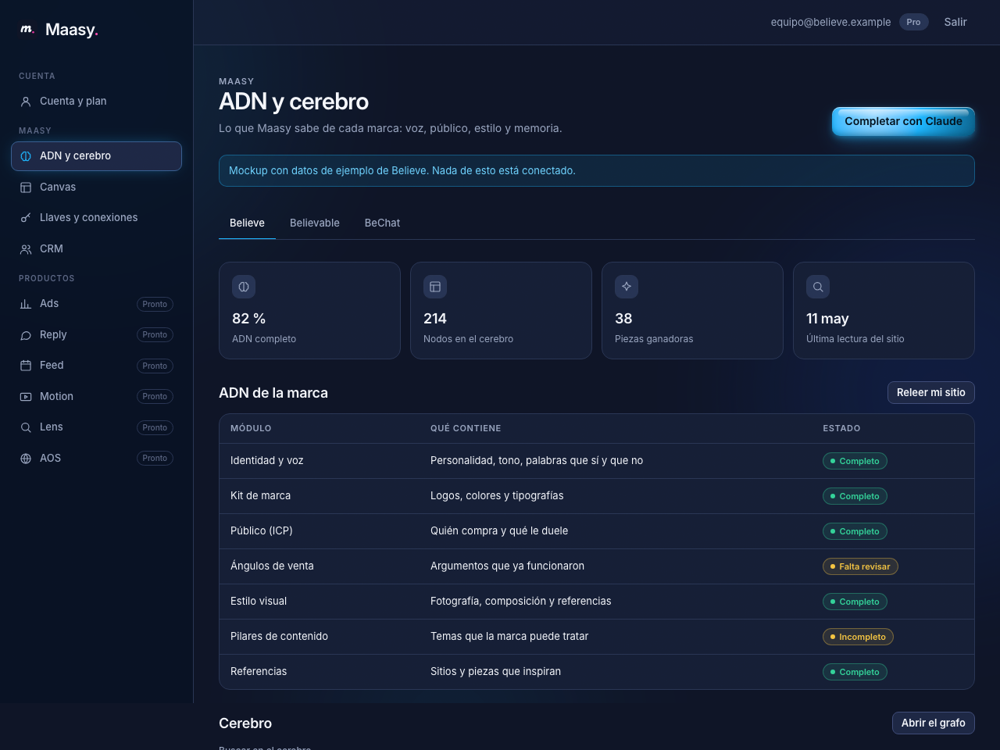
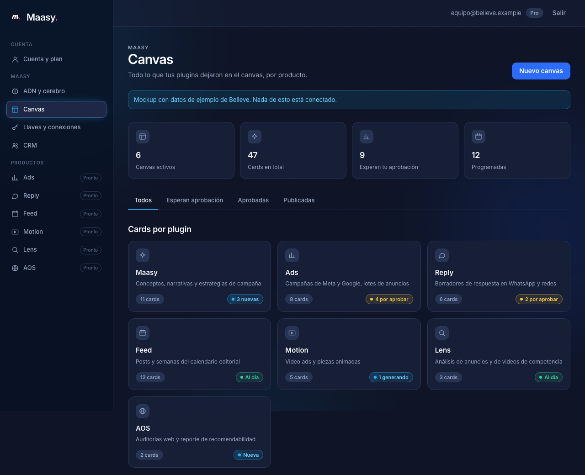
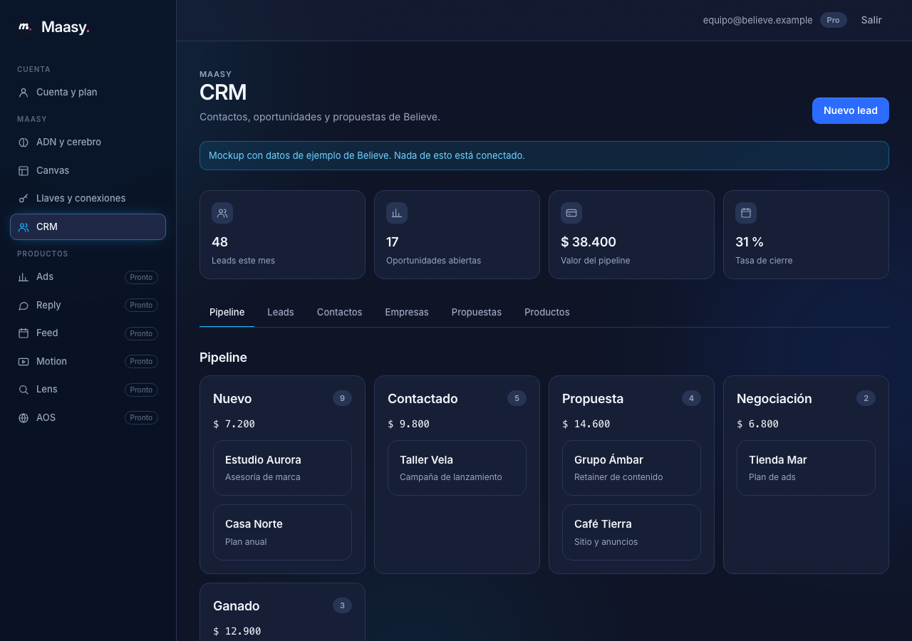
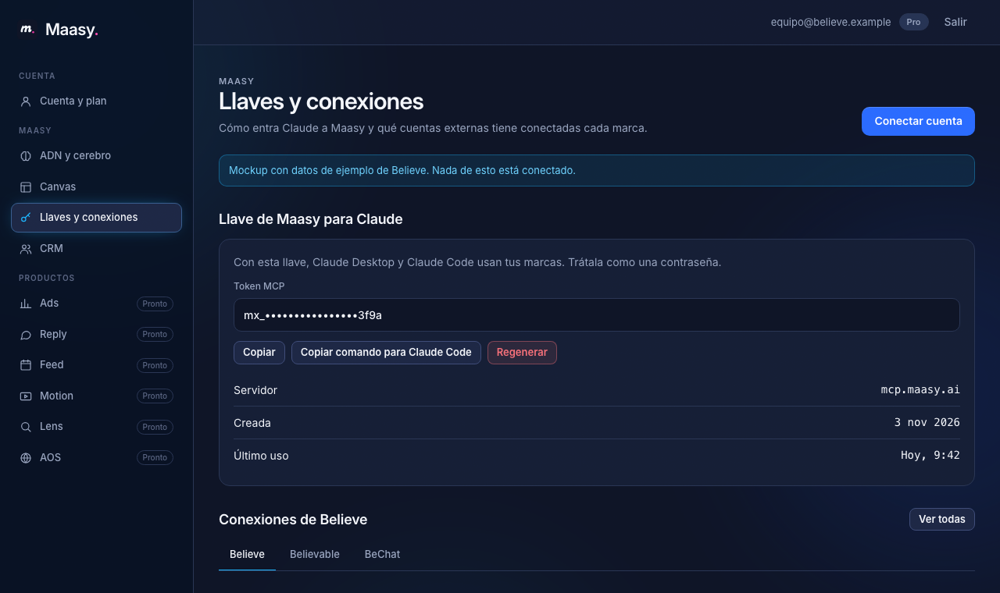
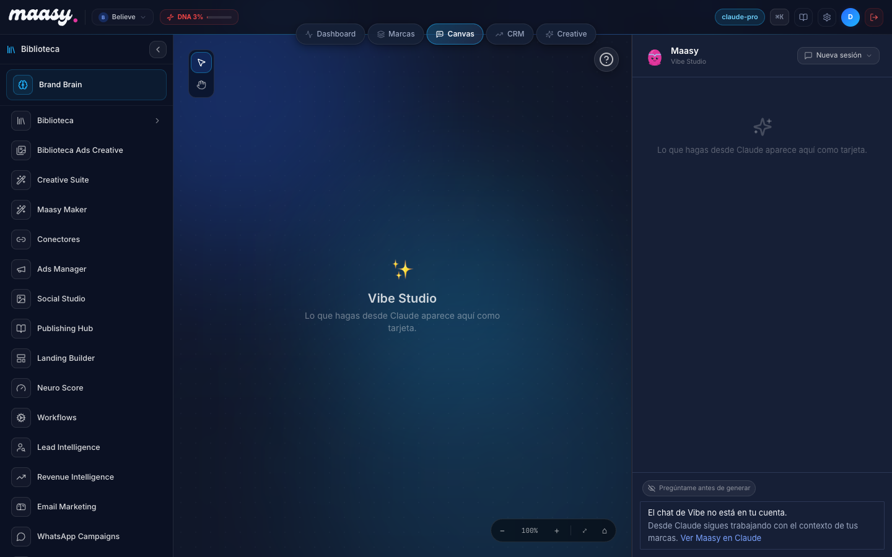
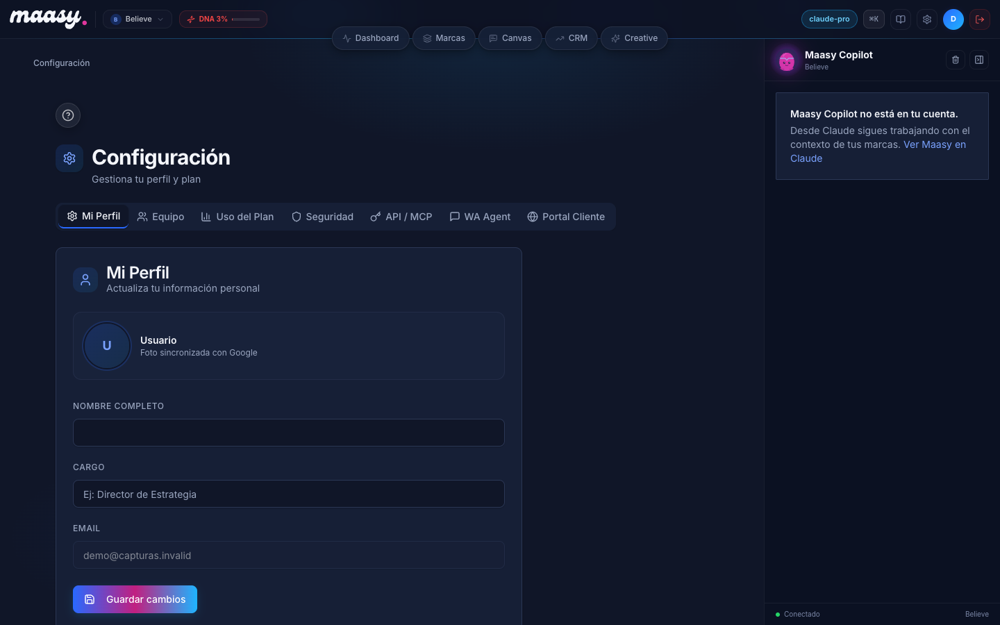

# La web de Maasy para quien llega de Claude

La web de Maasy (maasy.ai) es el panel de control de tu cuenta. Claude trabaja; aquí decides. Es donde ves tu marca, apruebas lo que Claude preparó, conectas tus cuentas y pones tus llaves. Para quien llega desde Claude, la web se reduce a lo que ese recorrido usa.

```figura
<figure class="vx-fig" data-alt="Recorrido en siete pasos: instalar, cuenta, entrevista, marca creada, un plugin genera una pieza, la pieza llega al canvas como tarjeta, tú la apruebas o descartas.">
  <div class="vx-head">Del primer comando a una pieza aprobada</div>
  <div class="vx-body">
    <div class="vx-flow">
      <div class="vx-node">Instalas<small>/plugin install</small></div>
      <div class="vx-node">Cuenta<small>/maasy:start</small></div>
      <div class="vx-node">Entrevista<small>Tarjetas</small></div>
      <div class="vx-node">Marca creada<small>ADN y cerebro</small></div>
      <div class="vx-node">Un plugin crea<small>Vibe, Motion, Feed...</small></div>
      <div class="vx-node">Tarjeta en el canvas<small>Desde Claude</small></div>
      <div class="vx-node vx-key">Tú decides<small>Apruebas o descartas</small></div>
    </div>
  </div>
  <figcaption>Todo lo que hace un plugin pasa por tu aprobación en el canvas. Y tu decisión le enseña al cerebro.</figcaption>
</figure>
```

## Secciones

La navegación tiene cuatro secciones para tu cuenta y una por cada producto.

| Sección | Para qué sirve |
|---|---|
| Cuenta y plan | Tu plan, cuántas marcas usas y cómo subir de plan |
| ADN y cerebro | Lo que Maasy sabe de cada marca: voz, público, estilo y memoria |
| Canvas | Donde llegan las piezas que crean tus plugins, para que las juzgues |
| Llaves y conexiones | La llave con la que Claude entra a Maasy y las cuentas externas que conectaste |
| CRM | Contactos, leads, oportunidades y pipeline |
| Feed, Reply y Games | Donde apruebas, programas y publicas lo que prepara cada plugin (ver más abajo) |
| Ads, Motion, Lens y AOS | Una sección por producto, con la etiqueta **Pronto** hasta que tenga la suya |

## Marcas

Arriba tienes el selector de marca. Si tienes varias, cada una tiene su propio ADN, su canvas, su CRM y sus conexiones. Lo que cambias en una no toca a las otras.

## ADN y cerebro

Muestra qué tan completo está el ADN y qué contiene cada módulo: identidad y voz, kit de marca, público, ángulos de venta, estilo visual, pilares de contenido y referencias. Cada módulo tiene su estado. Si algo falta o conviene revisar, el botón **Completar con Claude** te devuelve al chat con el comando listo.

Abajo está el cerebro: cuántas piezas y notas tiene cada grupo (marca, público, voz, competencia, producto, piezas ganadoras, piezas descartadas, cultura) y un buscador. El mapa de nodos completo se explora en la web.



## El canvas

El canvas es la bandeja de entrada de todo lo que hacen tus plugins. Cada pieza llega como una tarjeta dentro de una sesión llamada **Desde Claude**, con su plugin, su canal (Instagram, web, correo, TikTok, YouTube) y su estado.

| Estado | Qué significa |
|---|---|
| Por aprobar | Claude la dejó y espera tu decisión |
| Aprobada | La aprobaste; el cerebro la cuenta como ganadora |
| Descartada | La descartaste, con un motivo; el cerebro la recuerda para no repetirla |

Aprobar o descartar solo puede hacerlo una persona, en la web. Claude no tiene cómo aprobarse a sí mismo. Y esa decisión alimenta tu cerebro: las piezas ganadoras y las descartadas son lo que le enseña qué tienes que repetir y qué evitar.

Un detalle del plan gratis: el canvas es parte del plan Pro. Una marca con plan gratis no recibe tarjetas.



## CRM

Es el CRM de Maasy de siempre, con el look nuevo: leads, contactos, empresas, propuestas, productos y el pipeline por etapas. Claude lo lee (ver capítulo 3); las decisiones y las ediciones las haces tú aquí.



## Llaves y conexiones

Aquí viven las dos cosas que Claude no debe tener nunca a la mano.

- **La llave de Maasy para Claude.** Con ella Claude Desktop y Claude Code usan tus marcas. Trátala como una contraseña. Puedes copiarla, copiar el comando para Claude Code o regenerarla. Si la regeneras, la anterior deja de servir.
- **Las cuentas externas.** Meta, Google, WhatsApp y las demás cuentas que conectes, con su estado y su vencimiento. Aquí también pones, reemplazas o borras las llaves de IA que usa la medición de AOS. Después de pegarlas, solo se ve el proveedor y los últimos cuatro caracteres.
- **Conexiones de plugins.** Cada plugin que conectaste aparece con los permisos que le diste. Puedes revocar una o todas. Revocar corta el acceso en menos de un minuto.



## Feed, Reply y Games

Todo lo que hace la persona en estos productos pasa en la web de Maasy:

| Dónde | Qué haces |
|---|---|
| `maasy.ai/control/llaves` | Conectar tu cuenta de Instagram y tus otras cuentas |
| `maasy.ai/control/feed` | Aprobar o descartar las piezas de la semana, programarlas y publicarlas |
| `maasy.ai/control/reply` | Revisar y activar las campañas que Claude dejó en borrador |
| `maasy.ai/control/games` | Aprobar un juego o despublicarlo |

## Lo que no encuentras, y por qué

Si vienes de Claude, hay herramientas de la web de Maasy que no aparecen. Es una decisión, no un error. Son las que corren con IA de Believe y consumen créditos: el chat de Vibe, el Copilot de Maasy, el Autopilot y las generaciones con IA en la web. Desde Claude la IA la pones tú, así que esas pantallas se reemplazan por un aviso que te manda de vuelta al chat de Claude.





## Límites

- El mapa de nodos del cerebro se explora en la app web, no en Claude.
- Las secciones de Ads, Motion, Lens y AOS llegan con su producto.
- Los datos de las capturas de este capítulo son de ejemplo.

## Preguntas frecuentes

**¿Tengo que pagar para entrar a la web?** No. Con el plan gratis ves tu marca y tu ADN. El canvas, el CRM y las conexiones de plugins son del plan Pro.

**¿Puede Claude aprobar una pieza por mí?** No. Ninguna herramienta de Claude aprueba, descarta ni publica. Esa decisión solo se toma en la web, con tu sesión.

**¿La web está también en inglés?** Sí. El panel del canal de Claude (inicio de sesión, consentimiento, ADN, plan, llaves, conexiones y canvas) está pensado en español e inglés. El resto de la web sigue en español.
