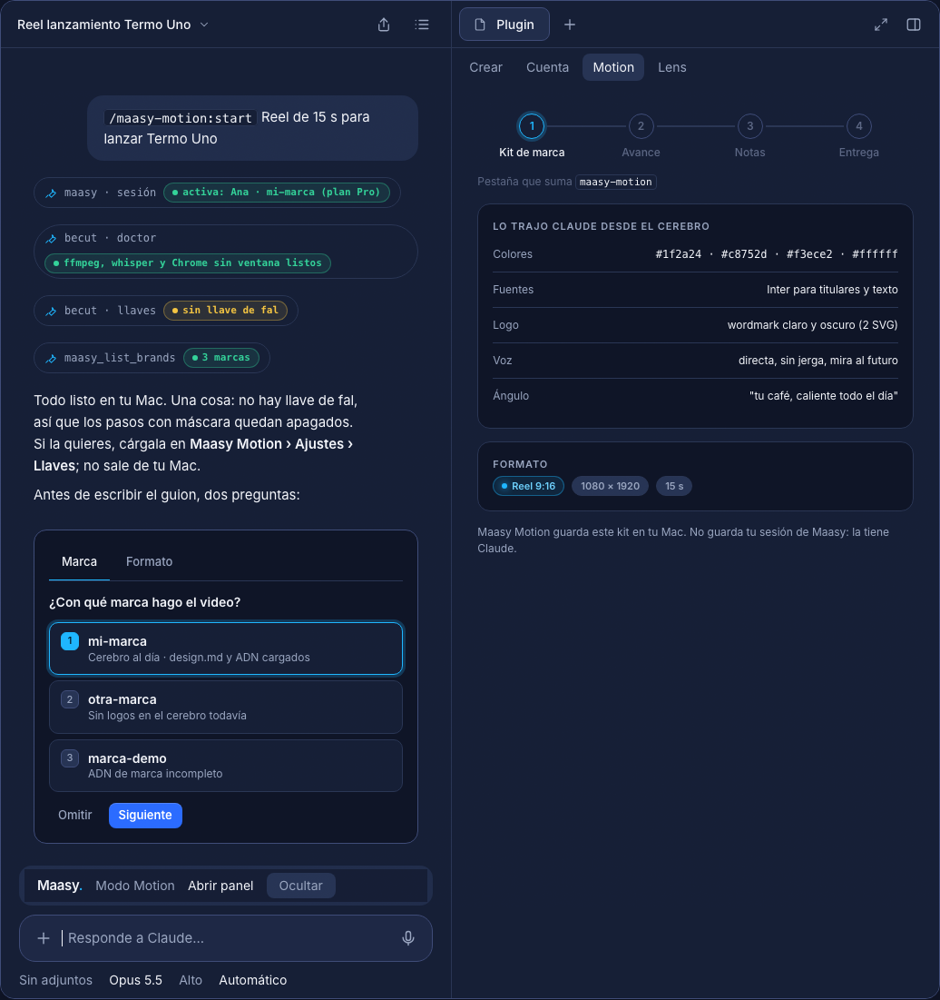
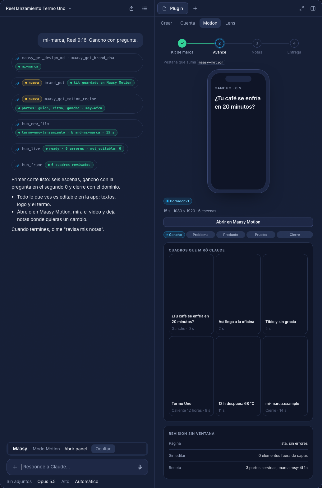

# Maasy Motion: videos con tu marca

`maasy-motion` hace videos con la marca de tu cerebro. Claude escribe el video como código, lo revisa por su cuenta y tú lo ves, lo corriges con notas y lo renderizas en la app Maasy Motion, en tu Mac.

> `PRÓXIMAMENTE` en la tienda. El plugin está en revisión (versión 0.2.0). Este capítulo describe cómo funciona.

## Para qué sirve

- Reels, videos de lanzamiento y piezas animadas de tu marca, con tus colores, tus fuentes, tu logo y tu voz.
- Corregir con notas, en la propia app, sin volver a pedir todo.
- Mandar el resultado final al canvas de tu marca para que lo apruebes.

## Qué necesitas

- Un Mac con chip Apple (M1 o más nuevo) y macOS 13 o superior.
- Los plugins `maasy` (con tu sesión y una marca creada) y `maasy-motion`.
- La app **Maasy Motion** instalada y abierta una vez. Se descarga en `files.believe-global.com/apps/maasy-motion/`. Trae su propio ffmpeg: no necesitas Homebrew.
- El plan Pro, porque el video toma la marca de tu cerebro.

## Cómo se instala

```
/plugin install maasy-motion@maasy
```

Después instala la app Maasy Motion desde su DMG y ábrela una vez. La app se actualiza sola y vuelve a la versión anterior si algo falla.

## Paso a paso

Escribe `/maasy-motion:start` con lo que quieres: `/maasy-motion:start un reel de 15 segundos para lanzar mi termo`.

**1. Sesión.** Claude comprueba que `maasy` está conectado. Si no, te dice que instales el núcleo y corras `/maasy:start`.

**2. La app.** Claude revisa que Maasy Motion esté instalada y que sus piezas funcionen. Si falta algo, te muestra el arreglo de cada una y espera.

**3. La marca.** Si tienes varias marcas, eliges con una tarjeta. Claude trae tu design.md, tu ADN y tus logos y se los pasa a la app, que guarda un kit de marca en tu Mac. La app no guarda tu sesión de Maasy: esa la tiene Claude.



**4. El método.** Claude pide a Maasy la receta de Motion por partes, la que cada paso necesita, y la sigue. Esa receta es de Maasy y llega marcada con tu cuenta: no se copia al chat entero ni a tus archivos.

**5. El video.** Claude crea el film, lo muestra en la app, mira sus propios cuadros y te avisa cuando hay un primer corte. Todo lo que ves se puede editar en la app: textos, logo y elementos.



**6. Tus notas.** Abre el video en Maasy Motion, míralo y deja notas donde quieras un cambio. Cuando termines, dile a Claude que las revise.

**7. El render.** Claude no renderiza. El render lo haces tú, en la app, cuando el video te gusta.

**8. Al canvas, con tu permiso.** Con un render final, Claude te pregunta si lo manda al canvas de tu marca. Solo con un sí explícito sube un póster y el video. El envío debe pesar menos de 50 MB; si tu render pesa más, pide uno más liviano. En la web de Maasy ves la tarjeta y tú la apruebas o la descartas.

Cuando empiezas un video nuevo, Claude revisa qué aprobaste y qué descartaste antes en el canvas, y lo tiene en cuenta.

## Permisos

El comando deja leer y editar la carpeta de videos (`~/Movies/BeCut/films`) sin preguntar mientras corre. Para que tampoco pregunte en los mensajes siguientes, suma esto a tu configuración de Claude (`~/.claude/settings.json`, o con `/permissions`):

```
{ "permissions": { "allow": ["Read(~/Movies/BeCut/films/**)", "Edit(~/Movies/BeCut/films/**)"] } }
```

Si cambiaste la carpeta de trabajo, usa la que te dio la app.

## Llaves de servicios

Los pasos que usan servicios externos (generar imágenes o video con fal, voces con ElevenLabs, traducción con HeyGen) usan tus propias llaves. Se cargan en la app, en Ajustes, y **se quedan en tu Mac**. Maasy no las guarda y Claude nunca te las pide en el chat. Sin llave de fal, los pasos con máscara quedan apagados y el resto funciona.

## Subtítulos y límites del ffmpeg

La app trae un ffmpeg propio con aceleración por VideoToolbox. Ese ffmpeg no incluye `libass` ni `zscale`, así que:

- No hace reels con subtítulos quemados sobre un video grabado, ni conversión HDR.
- Los videos hechos como código (los films de Maasy Motion) no usan esas funciones, así que no se ven afectados.
- Si quieres subtítulos quemados, indica otro ffmpeg que los tenga en Ajustes (`tools.ffmpeg`).
- Importar un video desde un link necesita `yt-dlp` instalado en tu Mac.

## Límites

- Solo Mac con chip Apple. No hay versión para Windows.
- La app no empaqueta música sin licencia revisada para terceros.

## Preguntas frecuentes

**Claude dice que la app no responde.** Instala Maasy Motion desde su DMG y ábrela una vez. Después vuelve a escribir `/maasy-motion:start`.

**¿Dónde queda mi video?** En tu Mac, en `~/Movies/BeCut/films`. Lo que subes al canvas es una copia liviana y un póster.

**¿Puedo hacer videos sin el plan Pro?** El plugin toma la marca de tu cerebro, que es del plan Pro. Sin Pro no se carga la marca.
