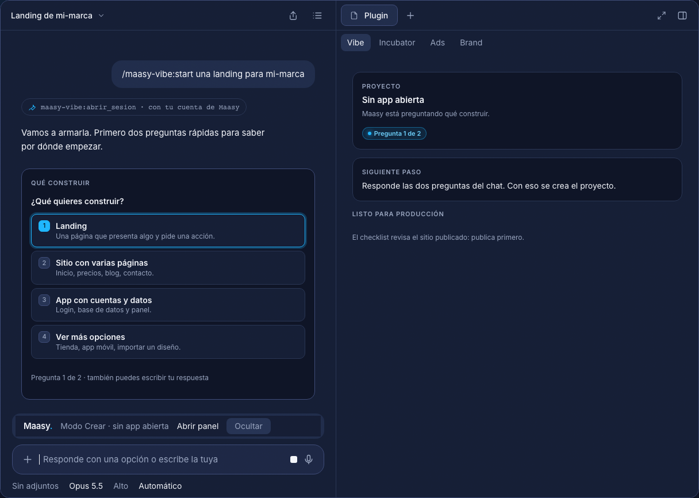
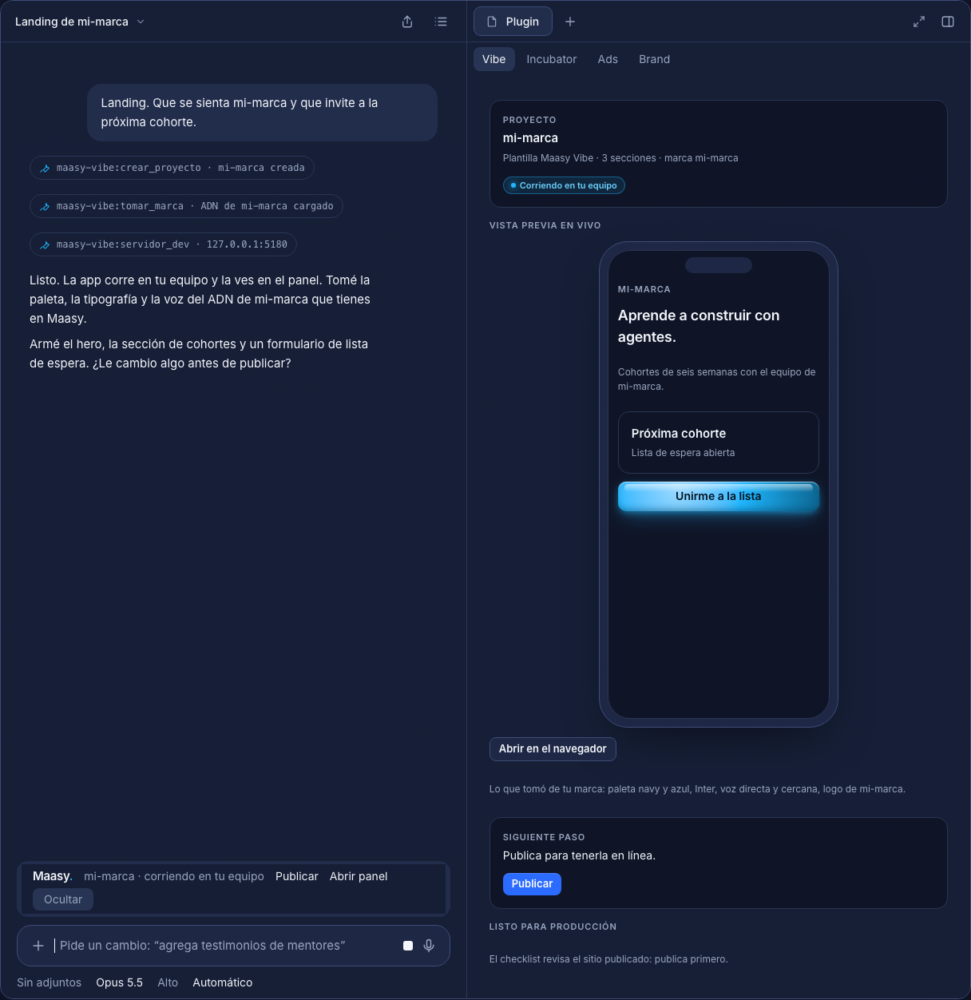
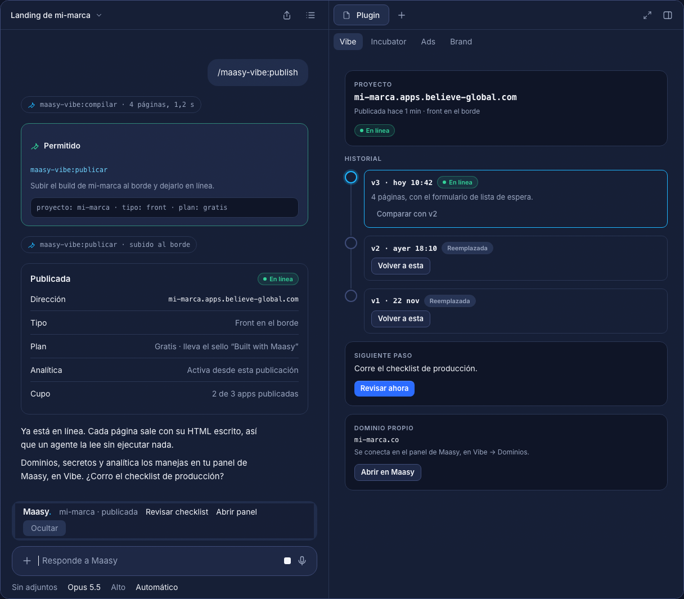

# Maasy Vibe: apps y landings con tu marca

`maasy-vibe` construye sitios y apps en tu computador con la marca que ya tienes en Maasy, y los publica en una dirección en línea. Cada página sale con su HTML ya escrito, así que un buscador o un agente de IA la lee sin ejecutar nada.

## Para qué sirve

- Una landing que presenta algo y pide una acción.
- Un sitio de varias páginas: inicio, precios, blog, contacto.
- Una app con cuentas, base de datos y panel.
- Una tienda, una app móvil o una app a partir de un diseño que ya tienes.

La app toma tu paleta, tu tipografía, tu voz y tu logo del ADN de tu marca. Tú no los repites.

## Cómo se instala

```
/plugin install maasy-vibe@maasy
```

Necesita el núcleo `maasy` y una marca creada (capítulos 2 y 3). Abre una conversación nueva al terminar.

## Paso a paso

### 1. Elegir qué construir

Escribe `/maasy-vibe:start`, con o sin una idea: `/maasy-vibe:start una landing para mi cafetería`. Claude hace dos preguntas con tarjetas: qué quieres construir y, según la respuesta, cómo quieres empezar.



Si ya estás dentro de una carpeta con tu proyecto, Claude lo detecta. Si la carpeta tiene archivos que la plantilla pisaría, Claude no borra ni mueve nada: te muestra la lista y te pregunta qué hacer.

### 2. Crear y ver

Claude crea el proyecto con la plantilla de Maasy Vibe (TanStack Start, con cada ruta generada como HTML). Arranca una vista previa en tu computador. La pestaña **Vibe** del panel la muestra al lado del chat, con lo que tomó de tu marca.



Pide cambios con tus palabras: "agrega testimonios", "la sección de precios con tres planes". El trabajo se guarda con `git commit`; el proyecto trae un primer commit.

### 3. Publicar

`/maasy-vibe:publish` compila el sitio y lo sube. Claude te da la dirección (`<id>.apps.believe-global.com`) y verifica que responde.

La primera vez necesitas entrar con tu cuenta de Maasy: `/maasy-vibe:login publicar`. El navegador se abre, terminas ahí y vuelves a Claude.



Publicar de nuevo actualiza la misma app, no crea otra. El historial guarda cada versión y puedes volver a una anterior.

### 4. Revisar que esté lista

`/maasy-vibe:check` revisa el sitio publicado en dos grupos, Web y Agentes (qué tan bien lo leen buscadores y asistentes de IA). Cada ítem sale como bien, falta o no aplica. Si falta algo, Claude ofrece arreglarlo en tu código. Nunca inventa datos de tu empresa, cifras ni afirmaciones: te pregunta y deja marcado lo que tienes que completar. Con los arreglos hechos, vuelve a compilar y te propone publicar de nuevo.

### 5. Operar en Maasy

Los dominios propios, los secretos de tu app, las herramientas MCP que expone y la analítica se manejan en la web de Maasy, sección Vibe. Nada de eso pasa por el chat, porque piden llaves o la aprobación del dueño.

## Todos los comandos

| Comando | Qué hace |
|---|---|
| `/maasy-vibe:start` | Empieza: eliges qué construir y Maasy te guía |
| `/maasy-vibe:new` | Crea una app nueva con la plantilla |
| `/maasy-vibe:publish` | Compila y publica en `<id>.apps.believe-global.com` |
| `/maasy-vibe:check` | Revisa si la app está lista para la web y para agentes, y arregla lo que falta |
| `/maasy-vibe:movil` | Convierte el proyecto en app iOS y Android y la sube a TestFlight o a la prueba interna de Google Play |
| `/maasy-vibe:unpublish` | Despublica la app y libera el cupo del plan |
| `/maasy-vibe:login` | Entra con tu cuenta de Maasy o con la de Believable de siempre. También acepta `maasy`, `believable`, un correo o `publicar` |
| `/maasy-vibe:logout` | Cierra tu sesión en este equipo |

### App móvil

`/maasy-vibe:movil` revisa qué tiene tu proyecto, lo convierte a app nativa si hace falta y lo sube:

- **iOS:** conecta App Store Connect una vez con el identificador de tu llave, el identificador del emisor y la **ruta** del archivo de la llave. Después sube a TestFlight. Apple tarda entre 5 y 25 minutos en procesar el build.
- **Android:** conecta Google Play una vez con la **ruta** del archivo de tu cuenta de servicio. Después sube a la prueba interna.
- Tus credenciales viven en el llavero de tu computador. Claude nunca lee ni pega el contenido de esos archivos, solo su ruta. Después de conectar puedes borrarlos.
- Lo que solo tú puedes hacer (iniciar sesión con tu Apple ID, el código de doble factor, crear la app en Play Console) Claude te lo dice y espera.

### Despublicar

`/maasy-vibe:unpublish` pide tu confirmación y borra el sitio publicado. El código no se toca. Libera el cupo de tu plan, y si publicas de nuevo la app sale en una dirección distinta. Una app con backend o con dominio propio todavía no se despublica así: el mensaje te dice qué quitar primero.

## El Incubator

Dentro de Vibe vivirá el Incubator: un recorrido guiado para pasar de una idea a un negocio, con fases y revisión en cada una. Está `PRÓXIMAMENTE` (capítulo 15).

## Qué ves en pantalla

Claude te muestra cada herramienta que usa y pide permiso en las que publican. El panel tiene la pestaña **Vibe** con el proyecto, el siguiente paso, el historial de versiones y un checklist de producción. La franja sobre el cuadro de texto dice en qué modo estás.

## Límites

- La publicación tiene un cupo de apps según tu plan. Si se llena, Claude muestra el mensaje y te dice cómo liberar uno (por ejemplo, despublicando otra app).
- En el plan gratis de Vibe la app publicada lleva un sello pequeño, abajo a la derecha. Quitarlo es parte de un plan pago.
- La app vive en el borde de Believe (`apps.believe-global.com`). Los dominios propios se conectan en la web de Maasy.
- Una app de otra cuenta no se puede publicar desde la tuya.
- La vista previa de Claude Desktop solo ve los proyectos creados en la carpeta de la sesión. Si creaste el proyecto en otra, abre una sesión ahí.

## Preguntas frecuentes

**¿Necesito saber programar?** No para pedir cambios y publicar. Sí conviene entender lo básico de carpetas y de `git` si quieres revisar el código.

**Publiqué y no veo mis cambios.** Compila de nuevo (`npm run build`) y publica otra vez. `/maasy-vibe:publish` lo hace por ti.

**El comando dice que no hay sesión.** Escribe `/maasy-vibe:login`. Si es para publicar, `/maasy-vibe:login publicar`.

**¿Qué guarda el archivo `.believable/project.json` de mi proyecto?** El identificador de publicación, para que publicar de nuevo actualice la misma app. No guarda secretos y va al repositorio.
