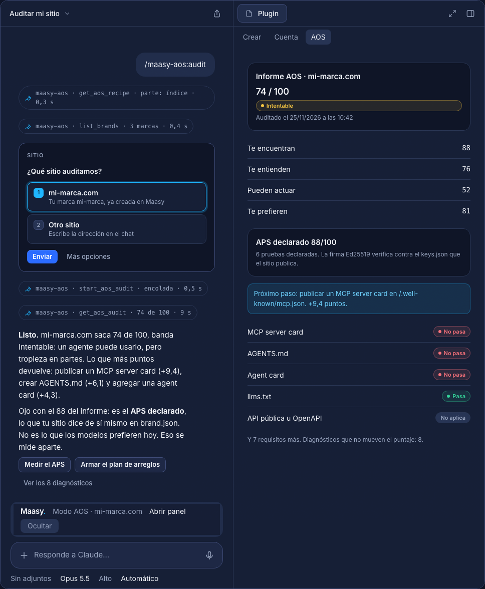
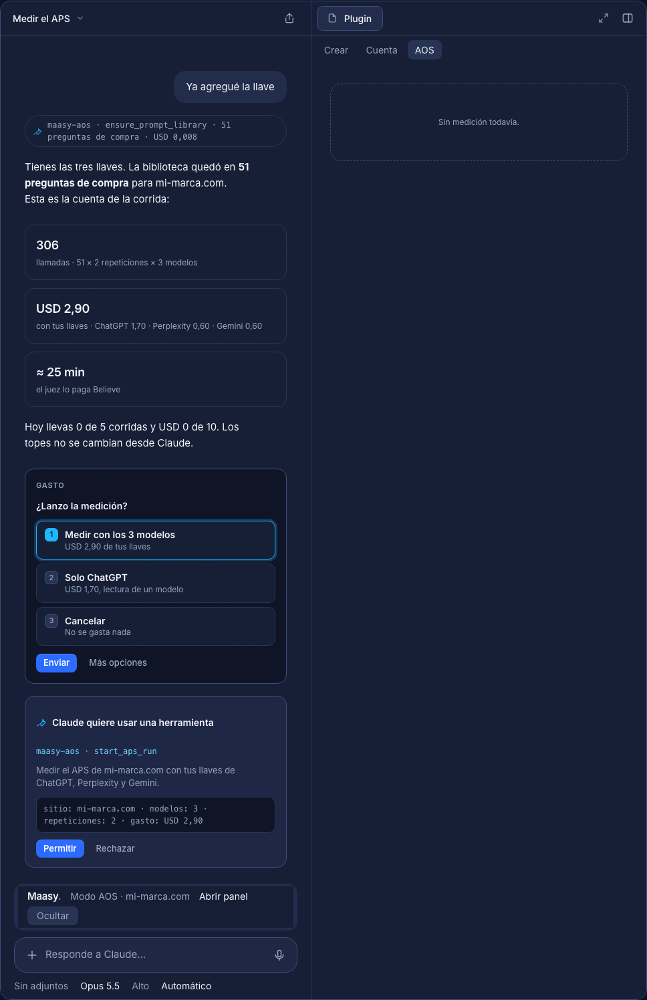

# Maasy AOS: cómo te ven las IA

`maasy-aos` mide qué tan bien pueden usar tu sitio los agentes de IA y qué tanto te recomiendan los modelos. Tiene dos números que no hay que confundir: el AOS, que audita tu sitio, y el APS, que mide la preferencia de los modelos por tu marca.

> `PRÓXIMAMENTE`. El diseño está aprobado y el plugin todavía no está en la tienda. Este capítulo describe cómo va a funcionar. AOS y APS los sirve BeAOS, la plataforma de medición de Believe.

## Para qué sirve

- Saber si un agente de IA puede leer tu sitio, entender qué vendes y actuar (comprar, reservar, contactarte).
- Ver qué arreglos te devuelven más puntos, ordenados por impacto.
- Medir con respuestas reales de modelos si te recomiendan cuando alguien pregunta por tu categoría.

## Los dos números

| Número | Qué mide | Cómo se obtiene |
|---|---|---|
| **AOS** | Qué tan operable es tu sitio para agentes. De 0 a 100, en cuatro grupos: te encuentran, te entienden, pueden actuar y te prefieren | Una auditoría de tu sitio: unas 10 consultas HTTP, sin IA |
| **APS declarado** | Lo que tu sitio dice de sí mismo en sus pruebas y afirmaciones firmadas | Sale de la misma auditoría |
| **APS medido** | Lo que los modelos de verdad prefieren hoy | Respuestas de modelos reales a preguntas de compra de tu categoría, con **tus** llaves de IA |

El APS declarado y el APS medido son cosas distintas. Un sitio puede declarar un puntaje alto y quedar muy abajo en el medido. El declarado es lo que tú dices; el medido es lo que los modelos devuelven. Claude te dice siempre cuál de los dos te está mostrando.

## Cómo se instalará

```
/plugin install maasy-aos@maasy
```

Necesita `maasy` con una marca y el plan Pro. Para medir el APS necesitas tus propias llaves de IA, cargadas en la web de Maasy.

## Paso a paso

**1. Auditar tu sitio.** `/maasy-aos:audit`. Claude te pregunta qué sitio (el de tu marca u otro) y lanza la auditoría. Cuando termina te da el puntaje, la banda en la que quedas y qué te devuelve más puntos: por ejemplo publicar una tarjeta de tu servidor MCP, un archivo `AGENTS.md` o una tarjeta de agente.



**2. Cargar tus llaves.** Para medir, la plataforma usa tus llaves de ChatGPT (OpenAI), Perplexity y Gemini. Las pones una vez en la web de Maasy, sección **Llaves y conexiones**. Se escriben una vez y después solo se ven los últimos cuatro caracteres. Si te falta una, Claude no encola nada y te da el camino exacto. También puedes medir solo con los modelos que tengas.

**3. Medir el APS.** `/maasy-aos:measure`. Antes de gastar, Claude te muestra la cuenta de la corrida: cuántas preguntas de compra se hacen, cuántas llamadas, cuánto cuesta con tus llaves y cuánto demora. Nada corre sin tu sí, y Claude te pide el permiso de la herramienta.



**4. Publicar tu perfil (opcional).** `/maasy-aos:publish` publica el perfil firmado de tu marca para que los agentes lo lean.

## Lo que paga cada parte

- **Tus llaves** pagan las respuestas de los modelos que mide tu APS.
- **Believe** paga al juez que califica esas respuestas, como parte del servicio de medición que cobra tu plan.
- Hay topes por día de corridas y de gasto. Se cambian en la web de Maasy, no desde Claude. El diseño muestra, de ejemplo, 5 corridas y 10 dólares por día; las cifras finales se confirman al lanzar.

## Qué ves en pantalla

La pestaña **AOS** del panel guarda el informe de tu sitio: el puntaje, los cuatro grupos, los diagnósticos y el próximo arreglo con sus puntos. Mientras no hayas medido, dice "Sin medición todavía".

## Límites

- AOS audita sitios públicos. No inicia sesión en tu sitio.
- Una medición con dos modelos da una lectura más corta que con tres.
- El APS medido depende de lo que respondan los modelos ese día: cambia entre corridas. Mira la banda de variación, no un solo número.
- Las llaves de modelos viven en la plataforma de medición, cifradas, y no se devuelven nunca. Si falta una, la corrida no cae a las de Believe.

## Preguntas frecuentes

**¿Por qué mi sitio saca 88 en el declarado y mucho menos en el medido?** Porque son dos cosas. El declarado es lo que tu sitio afirma de sí mismo. El medido es lo que los modelos reales prefieren cuando les preguntan por tu categoría. Mejorar el medido lleva trabajo y tiempo.

**¿Por qué necesito mis llaves?** Porque Believe no revende IA. La medición usa tus modelos; tú pagas lo que usas.

**¿Se puede medir sin llaves?** La auditoría de tu sitio (el AOS y el APS declarado) no necesita llaves. Medir el APS sí.
