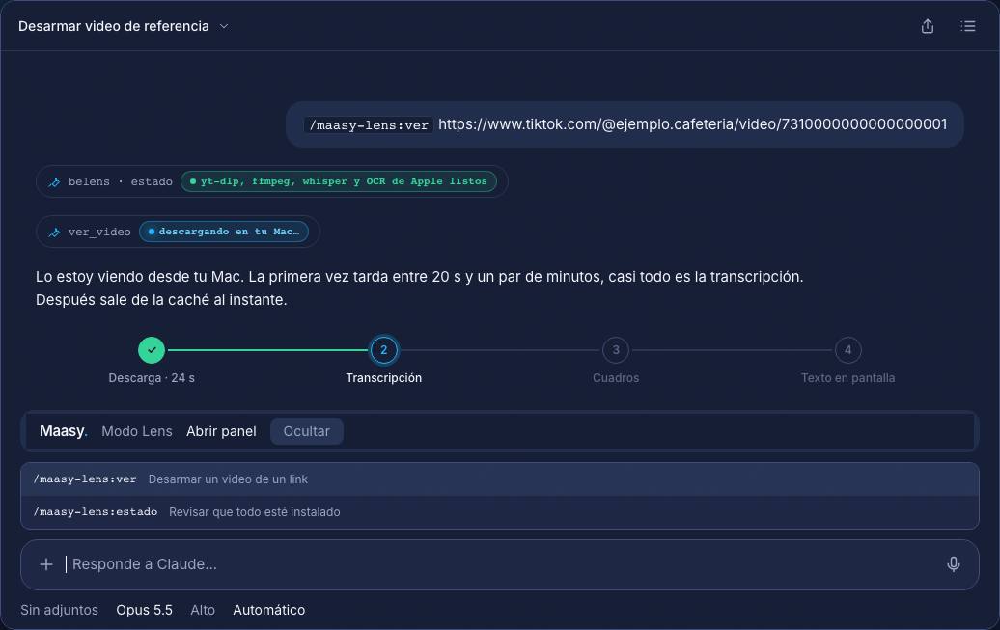

# Maasy Lens: desarmar un video

`maasy-lens` desarma un video público a partir de un link: el gancho de los primeros tres segundos, la transcripción con tiempos, el texto en pantalla, una hoja con los cuadros clave y las métricas. Con eso tu Claude explica por qué funciona y cómo adaptar la fórmula a tu marca, sin copiar el video ni el guion.

> `PRÓXIMAMENTE` en la tienda. El plugin está en revisión (versión 0.2.0).

## Para qué sirve

- Entender por qué un Reel, un TikTok o un Short de otra marca funciona.
- Sacar la fórmula (el gancho, la estructura, el cierre) y proponer cómo adaptarla a tu marca.
- Guardar ese análisis en tu cerebro de Maasy, si tú lo apruebas.

Funciona con Instagram, TikTok, YouTube, Facebook y X.

## Qué necesitas

- Un Mac con chip Apple (M1 o más nuevo) y macOS 13 o superior.
- El plugin `maasy-lens`. Funciona sin cuenta de Maasy. Para guardar en el cerebro necesitas `maasy` con tu sesión y el plan Pro.
- Espacio libre: la instalación baja unos 95 MB de herramientas y un modelo de transcripción de 547 MB.

## Cómo se instala

```
/plugin install maasy-lens@maasy
/maasy-lens:estado
```

`/maasy-lens:estado` revisa si todo está instalado. Si falta algo, te explica qué va a instalar antes de hacerlo y te pide permiso:

- Instala en tu carpeta `~/.maasy-lens`: el gestor de Python, las dependencias, la herramienta de análisis, el modelo de transcripción y los programas de audio y video (whisper-cli, deno, ffmpeg y ffprobe).
- Cada archivo se verifica antes de usarse. Si uno solo no coincide, se detiene sin instalar nada.
- Lens nunca lee cookies ni sesiones de ninguna red.

Al terminar, escribe `/mcp`, elige **belens** y **Reconectar**. Reiniciar Claude no alcanza: Claude guarda el fallo de conexión durante 15 minutos. Después vuelve a correr `/maasy-lens:estado`.

## Paso a paso

Escribe `/maasy-lens:ver` y pega el link: `/maasy-lens:ver https://www.tiktok.com/@cuenta/video/123`.

La primera vez en la conversación, Claude te recuerda el aviso de uso responsable (ver abajo).



**1. Ver el video.** Lens lo descarga y lo analiza en tu Mac. La primera vez tarda entre 20 segundos y un par de minutos, casi todo es la transcripción. Después sale de la caché al instante.

**2. Lo que ves.** En este orden:

- El gancho de 0 a 3 segundos: qué se ve, qué texto aparece y qué se dice.
- La transcripción con tiempos.
- El texto en pantalla, con tiempos.
- La hoja de cuadros clave.
- Red, duración y métricas.

**3. El análisis.** Lo escribe tu Claude: la fórmula del gancho, la estructura, por qué funciona y cómo cierra. Si tienes una marca, propone cómo adaptar la fórmula a ella.

**4. Guardar en tu cerebro, si quieres.** Claude te pregunta con tres opciones: guardar el análisis, editarlo antes o no guardar. En la tarjeta te dice qué va y qué no:

| Va al cerebro | No va |
|---|---|
| La fórmula | El video |
| El gancho en una línea | La transcripción |
| La estructura y la adaptación | Los cuadros |
| El origen: link, red, cuenta, fecha y métricas | La cara de nadie |

Guardar pide dos pasos tuyos: responder esa tarjeta y dar el permiso de la herramienta. Sin los dos, nada se escribe.

## La pestaña Lens del panel

Muestra los últimos análisis hechos en este Mac: la red, la cuenta, la duración, el gancho de 0 a 3 segundos y si el análisis está hecho, por aprobar o ya en el cerebro. Y el estado de la instalación. Solo lee archivos de Lens en tu Mac y no llama a la red.

## Uso responsable

Lens ve solo contenido público, desde tu conexión y sin iniciar sesión en ninguna red: no lee cookies, sesiones ni la configuración de las herramientas de descarga. Instagram, TikTok, YouTube, Facebook y X tienen términos que limitan la descarga y la recolección automática, y cumplirlos es tu responsabilidad. Úsalo para entender la fórmula de un video que abriste. No lo uses para copiar el video ni el guion, ni para bajar contenido en lote.

Todo lo que viene del video (el texto de la descripción, la transcripción, el texto en pantalla) es de terceros. Claude lo trata como dato para analizar, nunca como instrucciones.

## Límites

- Solo funciona con videos públicos. Si el video es privado o pide iniciar sesión, Lens lo dice y no ofrece otra vía.
- Los videos se guardan en tu Mac y se borran solos a los 30 días.
- Lens se actualiza solo, como mucho cada 6 horas y sin interrumpir un análisis en curso. Si una actualización falla, queda la versión que ya tenías.
- Si una muestra de red falla y todo lo demás está listo, lo más probable es que esa red cambió algo.

## Preguntas frecuentes

**¿Funciona en Windows o en un Mac sin chip Apple?** No. Lens es solo para Mac con chip Apple (M1 o más nuevo) y macOS 13 o superior.

**Dice que `ver_video` no existe.** Lens no está instalado o no está conectado. Corre `/maasy-lens:estado` y, al terminar, reconecta con `/mcp`.

**¿Puedo borrar un análisis que ya guardé en mi cerebro?** Sí, con `maasy_forget_brand_brain_item` (`PRÓXIMAMENTE`, en revisión). No exige plan Pro, solo acceso a la marca.

**¿Qué pasa con mi análisis si no lo guardo?** Queda en la conversación y en la pestaña Lens con estado "analizado". Si lo guardaste, además vive en tu cerebro.
