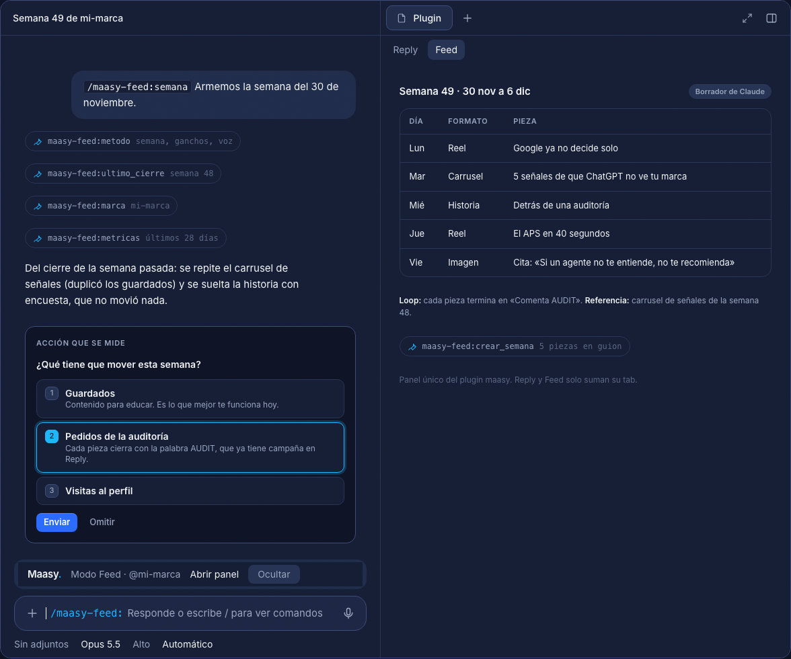

# Maasy Feed: tu Instagram orgánico

`maasy-feed` planea tu semana de Instagram y escribe las piezas con tu voz de marca. Las semanas y las piezas se guardan en BeFeed, el sistema de contenido orgánico de Believe. Claude las deja como guion; tú las apruebas, las programas y las publicas en el panel de BeFeed.

> Disponible en la tienda (versión 1.0.0).

## Para qué sirve

- Armar el plan de una semana: qué publicar cada día, en qué formato y con qué gancho.
- Escribir las piezas con el método de contenido de BeFeed y tu voz.
- Revisar cada pieza con un chequeo de voz que hace el servidor, no Claude.
- Aprender del cierre de cada semana y de tus métricas.

## Qué necesitas

- Los plugins `maasy` y `maasy-feed`, y una marca creada.
- Una cuenta de Maasy con plan Pro y acceso a la marca. Sin plan pago, `/maasy-feed:conectar` te lo dice y no insiste.
- Tu cuenta de Instagram, que conectas en el panel de BeFeed con su propio inicio de sesión. Claude no puede conectarla por ti.

## Cómo se instala

```
/plugin install maasy-feed@maasy
```

El plugin `maasy` se instala solo como dependencia. La primera vez que Claude llama a BeFeed, te pide entrar con tu cuenta de Maasy. El plugin no guarda ningún secreto.

Los permisos son por marca y vencen (90 días por defecto):

| Permiso | Para qué |
|---|---|
| `feed:read` | Leer marcas, métricas, semanas y el método |
| `feed:write` | Crear semanas y escribir piezas en guion |

## Paso a paso

### 1. Conectar la marca

`/maasy-feed:conectar mi marca` da de alta tu marca de Maasy en BeFeed. Claude busca la marca entre las tuyas (si hay más de una parecida, te pregunta cuál), la conecta y te dice hasta qué fecha dura el permiso. Si ya estaba conectada, renueva el permiso. Si tu Instagram todavía no está conectado, te da el enlace para hacerlo en el panel.

### 2. Escribir la semana

`/maasy-feed:semana <cuenta> [desde AAAA-MM-DD]`, por ejemplo `/maasy-feed:semana mimarca desde 2026-11-30`.

1. Claude confirma que la cuenta está conectada.
2. Pide el método de contenido de BeFeed y sigue su guía, parte por parte.
3. Antes de escribir, lee el cierre de la semana anterior, tu marca y tus métricas.
4. Crea la semana y cada pieza. Antes de guardar cada una, pasa el texto por el chequeo de voz del servidor y corrige lo que marque.
5. Cuando una pieza queda lista para revisión, la pasa a filtros. Si quieres una hora, Claude la deja como propuesta.



### 3. Aprobar y publicar

Aprobar, programar y publicar los haces tú en el panel de BeFeed. Claude nunca dice que algo quedó publicado.

## Las herramientas que usa Claude

| Herramienta | Qué hace |
|---|---|
| `marcas` | Lista tus cuentas conectadas |
| `alta_marca` | Conecta una marca de Maasy y renueva el permiso |
| `conectar_instagram` | Te da el enlace para conectar Instagram |
| `metodo` | Entrega el método de contenido, por secciones |
| `ultimo_cierre` | Lee el cierre de la última semana |
| `marca` | Lee los datos de la marca en BeFeed |
| `metricas` | Lee tus métricas |
| `crear_semana` | Crea la semana |
| `guardar_pieza` | Guarda una pieza en guion |
| `revisar_voz` | Revisa el texto contra tu voz, sin guardar |
| `pasar_a_filtros` | Marca una pieza como lista para revisión |
| `programar_pieza` | Deja una hora como propuesta |

## Lo que no hace

- No genera semanas con la IA de Believe ni produce reels. Escribe tu Claude, con el método de BeFeed.
- No aprueba, no programa y no publica.
- No conecta Instagram.

El método no viene en el plugin: BeFeed lo sirve siempre en su última versión.

## Preguntas frecuentes

**¿Puede Claude publicar por mí?** No. Claude deja borradores. Aprobar y publicar se hace en el panel de BeFeed.

**¿Por qué el servidor revisa mi voz y no Claude?** Porque el servidor aplica siempre las mismas reglas, con las palabras prohibidas y el tono de tu ADN.

**Mi marca no aparece.** Corre `/maasy-feed:conectar` con su nombre.

**¿Se conecta con Reply?** Una pieza puede terminar con una palabra clave que ya tiene su campaña en Reply (capítulo 13).
