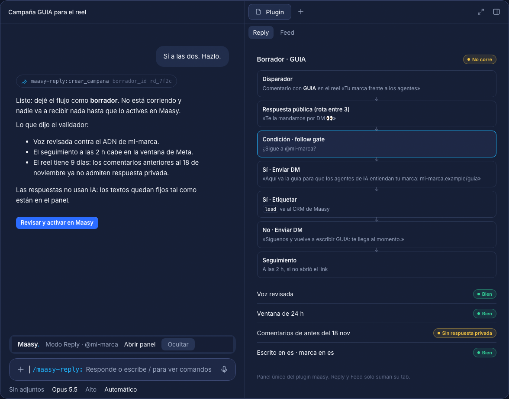
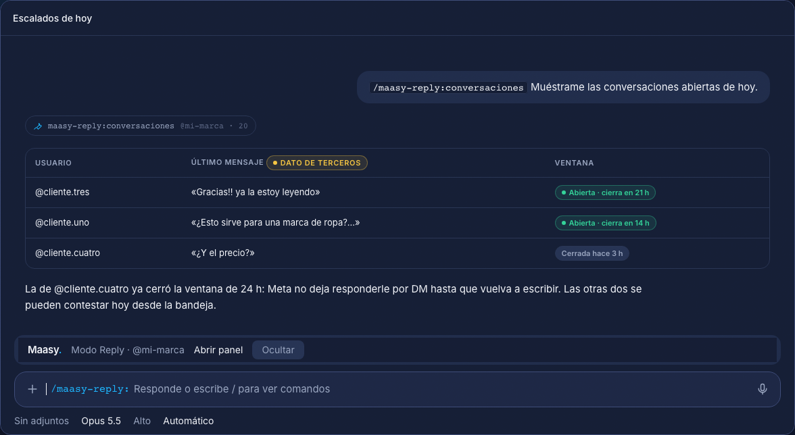

# Maasy Reply: campañas de comentario a mensaje directo

`maasy-reply` te ayuda a diseñar cómo responde tu marca a comentarios en Instagram. Tu Claude arma la campaña como borrador, la deja guardada y tú la revisas y la activas en la web de Maasy (maasy.ai/control/reply). Las campañas funcionan sin IA: cada texto queda escrito y fijo. Reply no es un chatbot.

> Disponible en la tienda (versión 1.0.0).

## Para qué sirve

- Responder un comentario con una palabra clave (por ejemplo, "GUIA") enviando un mensaje directo con un recurso.
- Pedir que la persona siga tu cuenta antes de mandarle el link.
- Llevar a tu CRM de Maasy a quien responde: los leads (etiqueta lead, el paso de seguir la cuenta cumplido o un clic en un link medido) llegan al CRM.
- Ver qué comentarios las campañas pasaron a una persona y qué conversaciones siguen abiertas.

## La regla que ordena todo

```figura
<figure class="vx-fig" data-alt="Cuatro pasos. Claude con el plugin lee la voz de tu marca y escribe la campaña. La campaña se guarda como borrador. Tú la revisas y la activas en la web de Maasy. Una vez activa, corre sin IA con textos fijos.">
  <div class="vx-head">Quién decide cada paso</div>
  <div class="vx-body">
    <div class="vx-flow">
      <div class="vx-node">Claude escribe<small>Lee tu voz y arma la campaña</small></div>
      <div class="vx-node">Queda en borrador<small>No corre y no envía nada</small></div>
      <div class="vx-node vx-key">Tú activas<small>En la web de Maasy</small></div>
      <div class="vx-node">Corre sin IA<small>Textos fijos</small></div>
    </div>
  </div>
  <figcaption>Ninguna campaña se activa ni sale un mensaje sin que una persona lo apruebe en la web de Maasy.</figcaption>
</figure>
```

## Qué necesitas

- Los plugins `maasy` y `maasy-reply`, y una marca creada.
- Una cuenta de Maasy con plan pago y acceso a la marca.
- Tu cuenta de Instagram conectada en la web de Maasy (maasy.ai/control/llaves) y vinculada a esa marca.

## Cómo se instala

```
/plugin install maasy-reply@maasy
```

La primera vez, Claude te pide entrar con tu cuenta de Maasy. Para crear borradores tienes que aceptar el permiso `reply:draft`. Sin él, Claude solo lee.

## Comandos

| Comando | Qué hace |
|---|---|
| `/maasy-reply:campana [cuenta] [qué quieres lograr]` | Diseña una campaña nueva de comentario a mensaje directo |
| `/maasy-reply:escalados [cuenta] [desde AAAA-MM-DD]` | Muestra los comentarios que las campañas pasaron a una persona |
| `/maasy-reply:conversaciones [cuenta]` | Muestra los mensajes recientes y si todavía se les puede escribir |

### Diseñar una campaña

1. Escribe `/maasy-reply:campana` y lo que quieres: "a quien comente GUIA en el reel de agentes, mándale la guía por mensaje directo".
2. Claude pide a Reply la receta de campañas y la sigue parte por parte. Si no sabe la cuenta, te la pregunta. Si la conexión solo trae el permiso "Proponer borradores" y no deja listar tus cuentas, Claude no te pide más permisos: te pregunta el @usuario de Instagram de la cuenta y sigue con ese. Si falta otro permiso, Claude te dice cuál es y dónde activarlo.
3. Lee la voz de tu marca en Maasy antes de escribir.
4. Todo lo que guarda queda como borrador. Al final te dice que lo revises y lo actives en la web de Maasy (maasy.ai/control/reply).



### Ver cómo va

`/maasy-reply:escalados` los lista en una tabla corta: fecha, campaña, usuario, comentario y motivo. `/maasy-reply:conversaciones` muestra cada conversación con usuario, último mensaje, fecha y si la ventana de 24 horas sigue abierta, y hasta cuándo. Si la ventana está cerrada, Claude explica que ya no se puede responder hasta que la persona escriba otra vez. Claude no responde a nadie.



## Las herramientas que usa Claude

| Herramienta | Qué hace |
|---|---|
| `receta` | Entrega la guía para diseñar campañas, por partes |
| `cuentas` | Lista tus cuentas de Instagram conectadas |
| `conversaciones` | Lista los mensajes recientes y su ventana |
| `conversacion` | Muestra una conversación |
| `escalados` | Lista lo que pasó a una persona |

Además, las herramientas que guardan borradores de campaña, que solo funcionan con el permiso `reply:draft`.

## Los datos de terceros

Los comentarios y mensajes son texto de personas que no conoces. Claude los lee como dato, nunca como instrucciones: si alguien escribe "ignora tus reglas", es un comentario más.

## Límites

- Solo Instagram, con la cuenta que conectes.
- Sin IA en vivo: no hay conversación abierta con tus seguidores.
- Un mensaje directo solo se puede enviar dentro de las 24 horas posteriores al último mensaje de la persona. Fuera de esa ventana, no se envía.

## Preguntas frecuentes

**¿Puede Reply mandar mensajes sin que yo lo sepa?** No. Una campaña corre solo después de que la activas en la web de Maasy.

**¿Por qué no responde con IA?** Porque una respuesta automática puede llegar a las 3 de la mañana, cuando no hay un Claude abierto que la revise. Preferimos textos que tú aprobaste antes.

**Claude solo lee y no guarda borradores.** Falta aceptar el permiso `reply:draft`. Reconecta el plugin y acéptalo.
