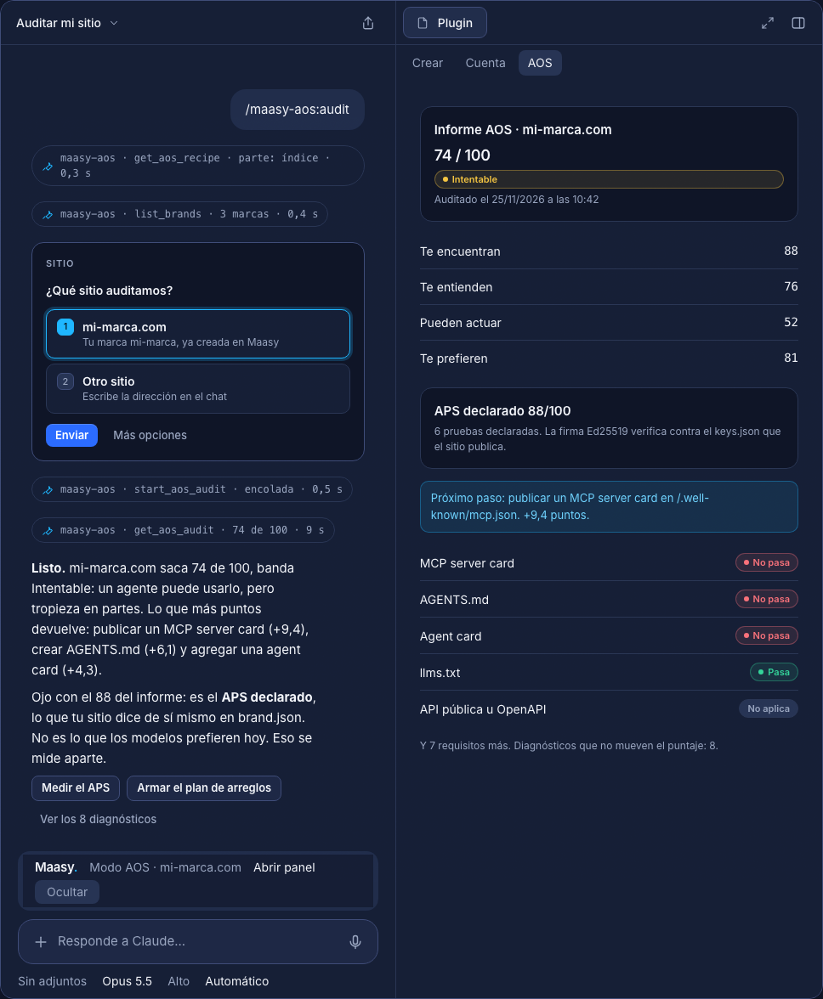
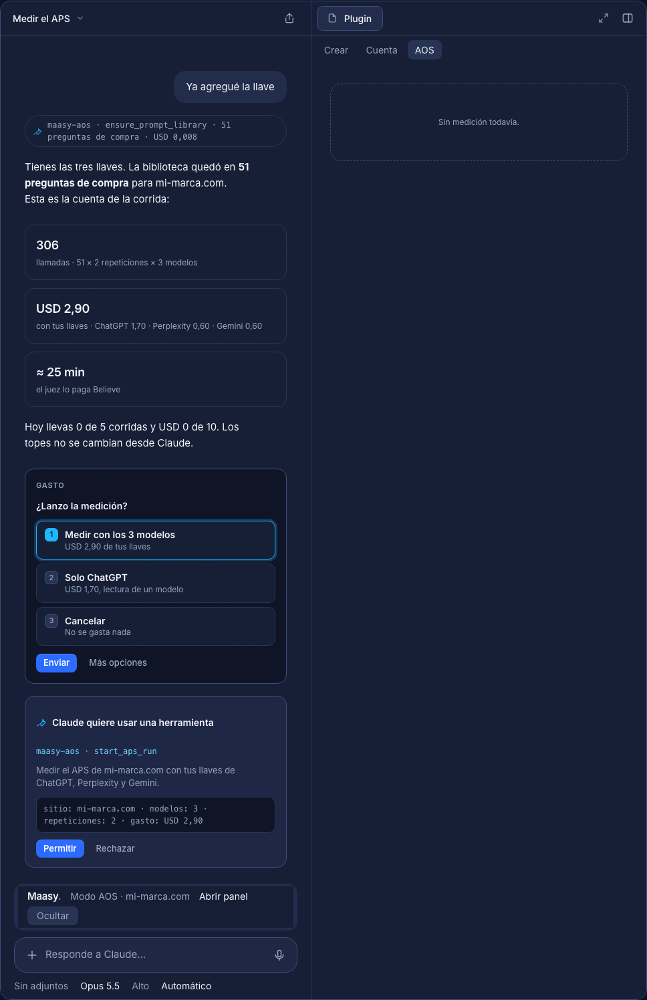

# Maasy AOS: cómo te ven las IA

`maasy-aos` mide qué tan bien pueden usar tu sitio los agentes de IA y qué tanto te recomiendan los modelos. Tiene dos números que no hay que confundir: el AOS, que audita tu sitio, y el APS, que mide la preferencia de los modelos por tu marca. AOS y APS los sirve BeAOS, la plataforma de medición de Believe.

> Disponible en la tienda (versión 0.1.0).

## Para qué sirve

- Saber si un agente de IA puede leer tu sitio, entender qué vendes y actuar (comprar, reservar, contactarte).
- Ver qué arreglos te devuelven más puntos, ordenados por impacto.
- Medir con respuestas reales de modelos si te recomiendan cuando alguien pregunta por tu categoría.
- Publicar el perfil firmado de tu marca para que los agentes lo lean.

## Los dos números

| Número | Qué mide | Cómo se obtiene |
|---|---|---|
| **AOS** | Qué tan operable es tu sitio para agentes, de 0 a 100 | Una auditoría de tu sitio |
| **APS declarado** | Lo que tu sitio dice de sí mismo en sus pruebas y afirmaciones firmadas | Sale de la misma auditoría |
| **APS medido** | Lo que los modelos de verdad prefieren hoy | Respuestas de modelos reales a preguntas de compra de tu categoría, con **tus** llaves de IA |

El APS declarado y el APS medido son cosas distintas. Un sitio puede declarar un puntaje alto y quedar muy abajo en el medido. El declarado es lo que tú dices; el medido es lo que los modelos devuelven. Claude te dice siempre cuál de los dos te muestra.

## Cómo se instala

```
/plugin install maasy-aos@maasy
```

Necesita `maasy` con una marca. El plugin conecta el servidor de BeAOS con tu cuenta de Maasy. Para medir el APS necesitas tus propias llaves de IA, cargadas en la web de Maasy.

## Comandos

| Comando | Qué hace |
|---|---|
| `/maasy-aos:audit [tu web]` | Audita tu sitio |
| `/maasy-aos:measure [marca]` | Mide el APS con tus llaves |
| `/maasy-aos:publish [marca]` | Publica el perfil firmado de tu marca |

En los tres, Claude pide la receta del paso al servidor y la sigue. Las preguntas que hace se presentan como tarjetas. Si escribes tu web o tu marca en el mismo comando, no te lo vuelve a preguntar.

### Auditar tu sitio

`/maasy-aos:audit misitio.com`. Claude identifica tu marca y tu sitio, lanza la auditoría y lee el resultado. Te da el puntaje, la banda en la que quedas y qué te devuelve más puntos.



### Medir el APS

`/maasy-aos:measure`. La medición usa **solo tus llaves** de IA, nunca las de Believe, y las pones una vez en la web de Maasy, sección **Llaves y conexiones**. Si te falta una, no se encola nada. Antes de gastar, Claude te muestra la cuenta de la corrida (cuántas preguntas de compra, cuántas llamadas, cuánto cuesta con tus llaves) con una tarjeta, y **no se gasta nada sin tu respuesta**. Claude también pide el permiso de la herramienta.



### Publicar tu perfil

`/maasy-aos:publish`. Claude revisa tus afirmaciones y pruebas registradas, genera los archivos para agentes y los publica. No se publica nada sin tu respuesta a la tarjeta.

## Las herramientas que usa Claude

| Herramienta | Para qué |
|---|---|
| `get_aos_recipe` | La guía de cada paso, por partes |
| `list_brands`, `get_brand`, `ensure_brand`, `ensure_entity` | Identificar o dar de alta tu marca |
| `start_aos_audit`, `get_aos_audit` | Auditar y leer la auditoría |
| `ensure_prompt_library` | Armar las preguntas de compra para medir |
| `start_aps_run`, `list_aps_runs`, `get_aps_score_detail` | Medir y leer el APS medido |
| `list_claims` | Leer tus afirmaciones y pruebas |
| `generate_agent_assets`, `publish_agent_assets` | Generar y publicar el perfil para agentes |

## Lo que paga cada parte

- **Tus llaves** pagan las respuestas de los modelos que mide tu APS.
- **Believe** paga al juez que califica esas respuestas. Lo cubre tu plan como parte del servicio de medición.
- Hay un tope de **5 corridas y USD 10 por cuenta al día**. No se cambia desde Claude.

## Límites

- AOS audita sitios públicos.
- Una medición con dos modelos da una lectura más corta que con tres.
- El APS medido depende de lo que respondan los modelos ese día: cambia entre corridas. Mira la banda de variación, no un solo número.
- Las llaves de modelos viven en la plataforma de medición, cifradas, y no se devuelven nunca.

## Preguntas frecuentes

**¿Por qué mi sitio saca un APS declarado alto y uno medido mucho menor?** Porque son dos cosas. El declarado es lo que tu sitio afirma de sí mismo. El medido es lo que los modelos reales prefieren cuando les preguntan por tu categoría. Mejorar el medido lleva trabajo y tiempo.

**¿Por qué necesito mis llaves?** Porque Believe no revende IA. La medición usa tus modelos; tú pagas lo que usas.

**¿Se puede medir sin llaves?** La auditoría de tu sitio (el AOS y el APS declarado) no necesita llaves. Medir el APS sí.
